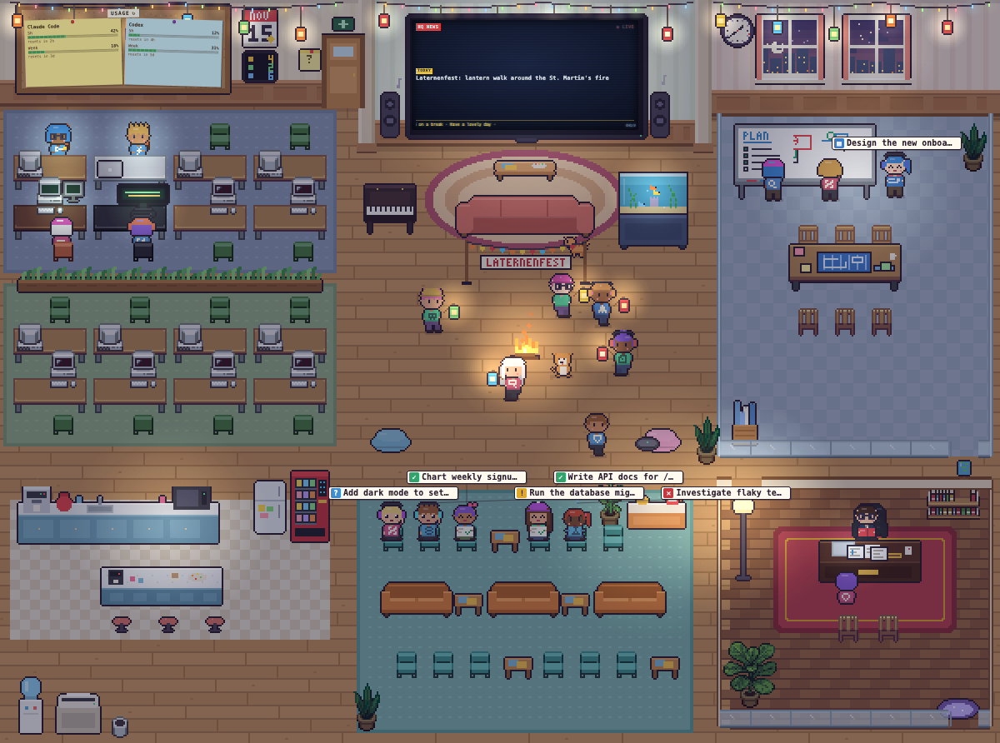
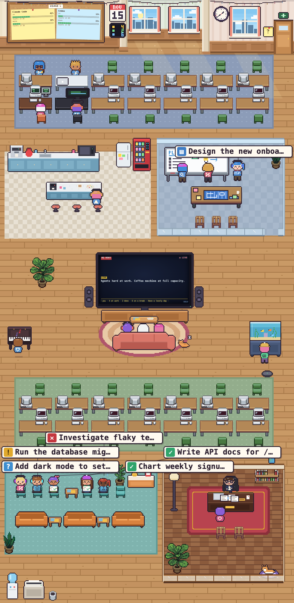

# Cozy HQ

A cozy pixel-art office for [bb](https://getbb.app). Every thread is a little
worker, and where it is in the office tells you what it's doing: busy ones at
their desks, planners at the whiteboard, threads that need you in the waiting
room, idle ones on a coffee break. It fills a whole panel and doubles as a
home screen.






## Install

Add [alexkli's bb plugins](https://github.com/alexkli/bb-plugins) once, then
install:

```sh
bb marketplace add git:https://github.com/alexkli/bb-plugins.git@main
bb plugin install cozy-hq@alexkli
```

Cozy HQ appears as **Cozy HQ** in bb's sidebar rail (route
`/plugins/cozy-hq/office`).

## Who sits where

| Thread state | In the office |
| --- | --- |
| Running, background work, queued message | At a desk; its screen scrolls code |
| Plan mode | Meeting room: sketching at the whiteboard, or at the table with papers and blueprints |
| Plan ready for your review | Meeting room, beside the whiteboard holding the blueprint |
| Asking a question, waiting for an approval | Waiting room, hand up |
| Finished, unread | Waiting room, holding its page |
| Errored, unread | Waiting room, under a rain cloud |
| You have an unsent draft for it | Your office, across the desk from you |
| Idle under 20 minutes | Kitchen: coffee, tea, fridge, vending machine, snacks |
| Idle up to 8 hours | Lounge: TV, piano, fish tank, darts, ping-pong, arcade |
| Idle longer | Napping on a beanbag |

Threads waiting for you get a title tag above their heads; the tags stack so
they never overlap, and clicking one opens the thread. So does clicking a
character. Desks are furnished by the thread's model (Opus walnut with dual
monitors, Sonnet oak, Haiku white with a laptop, GPT/Codex black with an
ultrawide), chairs by provider, and a shirt badge shows what the thread is
about.

## What else is going on

- **The wall is a home screen**: a pinboard with every enabled provider's
  usage, a calendar, a status light board, the door (a new thread), a cuckoo
  clock (hover for the time) and a big TV with HQ news, Hacker News headlines
  and your Work Dashboard inbox, if you use that plugin.
- **You're the boss** at the big desk, with Biscuit the corgi asleep in the
  corner. Pixel the cat, a roomba, the fish, a cleaning crew in the evening and
  a night guard on the occasional round keep the place alive.
- **Office events**: now and then idle threads gather for a party, birthday
  cake, pizza, karaoke, cornhole, darts, a stretch break or bring-your-kids-to-
  work day. Click the calendar to start one.
- **Festivals** through the year, each with decorations and its own party:

  | When | Festival |
  | --- | --- |
  | Jan | Snow day: hot cocoa and a snowman |
  | Jan/Feb | Lunar New Year: lanterns, red envelopes, a dragon dance |
  | Feb | Valentine's Day, Carnival (and on 11.11.) |
  | Mar | St. Patrick's Day, Holi |
  | Mar/Apr | Easter: an egg hunt, and eggs hidden around the office for you |
  | Apr–Jun | Maifest: dancing round the maypole |
  | Jun–Aug | Summer party: BBQ, lemonade, a beach ball |
  | Sep/Oct | Oktoberfest |
  | Oct | Halloween costume party, Diwali |
  | Nov | Laternenfest (a lantern walk round a St. Martin's fire), Thanksgiving |
  | Dec | The holidays: snow, a tree in your office, a holiday party |

  Easter, Carnival and Thanksgiving are computed for each year. Lunar New
  Year, Diwali and Holi follow lunar calendars and are looked up through 2030.
- **Click things**: the espresso machine, kettle, microwave, fridge, vending
  machine, piano, dartboard, printer, plants, globe, arcade, your lamp, your
  own desk (whistles for the dog) and more. Each does something, with a
  synthesized sound.
- **Day and night** follow your clock, with sunsets, stars and lamps, and
  rainy days now and then.
- **Office buddy**: an agent from the office strolls in a corner of bb
  wherever you are (drag it anywhere, click it to open Cozy HQ).
- **Fits any panel**: a wide floor plan in landscape, rooms stacked top to
  bottom on a phone held upright.

## Settings

Sound is in the office itself: click either speaker next to the TV for on/off,
volume and ambient sounds. Everything else:

```sh
bb plugin config cozy-hq                    # show
bb plugin config cozy-hq set buddy false    # the office buddy
bb plugin config cozy-hq set techNews false # Hacker News on the TV
bb plugin config cozy-hq set inbox false    # Work Dashboard inbox on the TV
```

## Privacy and network

- The office reads your threads, projects and providers through the plugin
  SDK, and usage from plugins that publish `provider-usage.v1` usage. It
  changes nothing.
- The only outside request is to the Hacker News API
  (`hacker-news.firebaseio.com`), at most every 20 minutes, for the TECH
  channel. Turn it off with `techNews false`.
- Only `http`/`https` links from headlines and inbox items are opened.
- Preferences (sound, the buddy's position, remembered desks, recent office
  news) stay in your browser's local storage.

## Develop

```sh
npm install
npm run typecheck
npm test            # node --test office/*.test.ts
bb plugin build . && bb plugin reload cozy-hq
```

To preview other times and states, set this in devtools on the bb page:

```js
localStorage["bb-plugin:cozy-hq:debug"] = '{"hour":20,"sample":true,"event":"lanterns"}'
```

- `hour` (0–24) and `rainy` set the time of day and the weather.
- `sample` replaces your threads, usage and headlines with made-up ones (the
  screenshots use it). `demo` dresses your first twelve threads up in every
  state instead.
- `event` keeps an office event running: `party`, `birthday`, `baby-shower`,
  `pizza`, `karaoke`, `cornhole`, `darts`, `kids`, `yoga`, `ice-cream`, or a
  festival: `snowday`, `lunarnewyear`, `valentines`, `carnival`, `stpatricks`,
  `holi`, `easter`, `maifest`, `summer`, `oktoberfest`, `halloween`, `diwali`,
  `lanterns`, `thanksgiving`, `holiday`.
- `season` decorates for a season whatever the date (`snowday`,
  `lunarnewyear`, `valentines`, `carnival`, `stpatricks`, `holi`, `easter`,
  `spring`, `summer`, `oktoberfest`, `halloween`, `diwali`, `laternenfest`,
  `thanksgiving`, `holidays`), or `none`.
- `expose` puts the world on `window.__cozyHq`.

Only the view changes. Remove the key to go back to normal.

| File | What |
| --- | --- |
| `app.tsx` | Panel and buddy registration, rail badge, data hooks |
| `server.ts`, `contract.ts` | Usage aggregation, Hacker News, Work Dashboard inbox |
| `office/model.ts` | Pure logic: thread mood, spot assignment, office news |
| `office/layout.ts` | Floor plans (wide and portrait) for the panel size |
| `office/world.ts` | Simulation and canvas renderer |
| `office/life.ts` | Hallway walking and office events |
| `office/seasons.ts` | Festival calendar, decorations and party decor |
| `office/characters.ts`, `office/furniture.ts`, `office/desks.ts` | Pixel sprites |
| `office/sound.ts` | Synthesized sound effects |
| `office/OfficeView.tsx`, `app.css` | Panel UI, TV, pinboard, tags, sound controls |
| `office/Buddy.tsx` | The office buddy overlay |
| `office/sample.ts` | Made-up data for screenshots |

## Credits

Desks, PCs, chairs, plants and a few other furniture sprites come from
[Pixel Agents](https://github.com/pixel-agents-hq/pixel-agents) (MIT); see
[ATTRIBUTION.md](ATTRIBUTION.md). Everything else is drawn and synthesized by
Cozy HQ's own code.

## License

MIT
