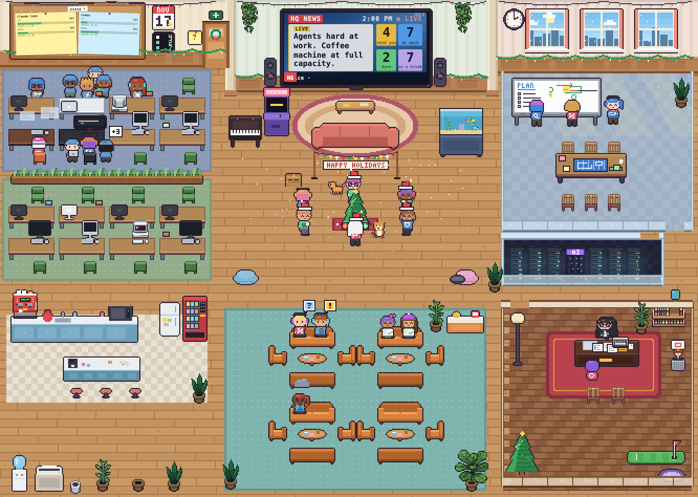
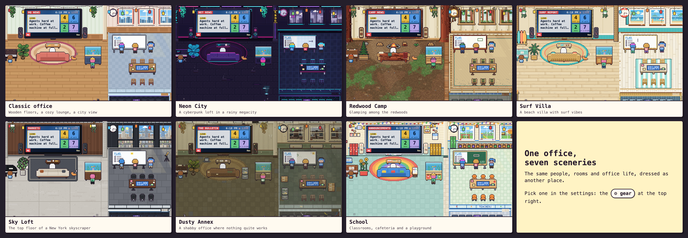
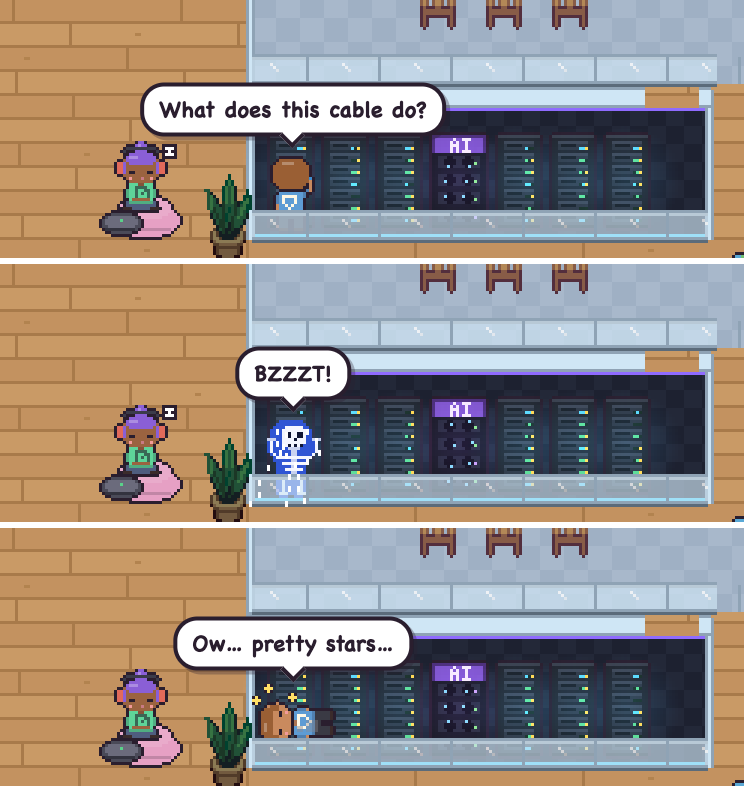
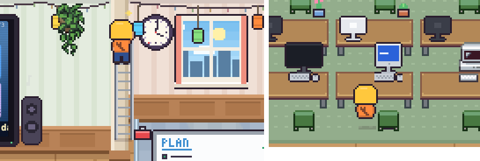

# Cozy HQ

A cozy pixel-art office for [bb](https://getbb.app). Every thread is a little
worker, and where it is in the office tells you what it's doing: busy ones at
their desks, planners at the whiteboard, threads that need you in the waiting
room, idle ones on a coffee break. It fills a whole panel and doubles as a
home screen.




## Install

Add [alexkli's bb plugins](https://github.com/alexkli/bb-plugins) once, then
install:

```sh
bb marketplace add git:https://github.com/alexkli/bb-plugins.git@main
bb plugin install cozy-hq@alexkli
```

Cozy HQ appears as **Cozy HQ** in bb's sidebar rail (route
`/plugins/cozy-hq/office`).

## Who sits where

| Thread state | In the office |
| --- | --- |
| Running, background work, queued message | At a desk; its screen scrolls code |
| Plan mode | Meeting room: sketching at the whiteboard, or at the table with papers and blueprints |
| Plan ready for your review | Meeting room, beside the whiteboard holding the blueprint |
| Asking a question, waiting for an approval | Waiting room sofas, hand up |
| Finished, unread | Waiting room, holding its page |
| Errored, unread | Waiting room, under a rain cloud |
| You have an unsent draft for it | Your office, across the desk from you |
| Idle under 20 minutes | Kitchen: coffee, tea, fridge, vending machine, snacks |
| Idle up to 8 hours | Lounge: TV, piano, fish tank, darts, ping-pong, arcade |
| Idle longer | Napping on a beanbag |

The **Names** button (top right) puts a name tag over everyone; the tags stack
so they never overlap, and clicking one opens the thread. So does clicking a
character. A solid chip with a red dot means unread, an outlined one read. Desks are furnished by the thread's model (Opus walnut with dual
flat screens, Sonnet oak, Haiku white with a laptop, GPT/Codex black with an
ultrawide; everyone else gets a flat screen, with the odd retro CRT), chairs
by provider, and a shirt badge shows what the thread is about. One or two
people work in a Vision Pro.

The office keeps going while you're elsewhere in bb, and it remembers what
everyone was doing when you last looked: coming back, only the threads whose
state changed since then get up and walk.

Idle threads get together every minute or so for a coffee, water-cooler
talk, a hallway chat, the couch, ping-pong or darts, mostly with comic speech
bubbles: small talk, a tech headline, or what the thread actually did last.
After noon they have lunch together at a long table: a delivery brings pizza,
sushi, burgers, tacos or ramen, and a few bring their own lunchbox.

## Sceneries

Pick a scenery in the settings (the gear at the top right) to dress the
office as another place. The people, rooms, events and everything that
happens stay the same; the look, the sounds and the words change:



| Scenery | |
| --- | --- |
| 🏢 Classic office | Wooden floors, a cozy lounge and a city view |
| 🌃 Neon City | A cyberpunk loft in a rainy megacity |
| 🌲 Redwood Camp | Glamping among the redwoods |
| 🏄 Surf Villa | A beach villa with surf vibes |
| 🏙️ Sky Loft | The top floor of a New York skyscraper |
| 🗄️ Dusty Annex | A shabby, forgotten office where nothing quite works |
| 🏫 School | An elementary and middle school |

Your pick is kept per browser; the buddy dresses to match.

## What else is going on

- **The wall is a home screen**: a pinboard with every enabled provider's
  usage, a calendar, a status light board, the door (a new thread), a cuckoo
  clock (hover for the time) and a big TV: HQ news with live head counts, the
  office weather and clock, Hacker News headlines and your Work Dashboard
  inbox, if you use that plugin. Click the TV to switch channels.
- **A small server room** with blinking racks and a glowing AI cluster (click
  it to train a model, and someone idle wanders over to have a look). Now and
  then someone messes with the cables, gets a (harmless) shock, lies on the
  floor seeing stars and shuffles back.

  
- **A technician** comes round in working hours to fix a crashed computer, a
  dead bulb in the string lights (up a ladder), the espresso machine, the
  printer or the vending machine, and the server rack after a shock.

  
- **You're the boss** at the big desk, with Biscuit the corgi asleep in the
  corner. Pixel the cat, a roomba, the fish, a cleaning crew in the evening and
  a night guard on the occasional round keep the place alive.
- **Office events**: now and then idle threads gather for a party, birthday
  cake, karaoke, cornhole, darts, a stretch break or bring-your-kids-to-work
  day, and for lunch every day after noon. Click the calendar to start one.
- **Festivals** through the year, each with decorations and its own party:

  | When | Festival |
  | --- | --- |
  | Jan | Snow day: hot cocoa and a snowman |
  | Jan/Feb | Lunar New Year: lanterns, red envelopes, a dragon dance |
  | Feb | Valentine's Day, Carnival (and on 11.11.) |
  | Mar | St. Patrick's Day, Holi |
  | Mar/Apr | Easter: an egg hunt, and eggs hidden around the office for you |
  | Apr–Jun | Maifest: dancing round the maypole |
  | Jun–Aug | Summer party: BBQ, lemonade, a beach ball |
  | Sep/Oct | Oktoberfest |
  | Oct | Halloween costume party, Diwali |
  | Nov | Laternenfest (a lantern walk round a St. Martin's fire), Thanksgiving |
  | Dec | The holidays: snow, a tree in your office, a holiday party |

  Easter, Carnival and Thanksgiving are computed for each year. Lunar New
  Year, Diwali and Holi follow lunar calendars and are looked up through 2030.
- **Click things**: the espresso machine, kettle, microwave, fridge, vending
  machine, piano, dartboard, printer, plants, globe, arcade, couch, beanbags,
  roomba, string lights, your lamp, your own desk (whistles for the dog) and
  more. Each does something, with a synthesized sound. Open a window to hear
  outside: birds, crickets at night, rain, wind, thunder or a foghorn.
- **Day and night** follow your clock, with sunsets, stars and lamps. **The
  weather outside is your real local weather**: sun, clouds, fog, drizzle,
  rain, snow or a thunderstorm with lightning, also on the TV.
- **Office buddy**: an agent from the office strolls in a corner of bb
  wherever you are (drag it anywhere, click it to open Cozy HQ). Inside a
  thread it's that thread's own figure. Its bubble counts the threads with
  news for you since you last looked at the office: yellow when one waits on
  you, red for an error, green when they're just done. No news, no bubble.
- **Rail badge**: the number on the Cozy HQ icon is the same count, so you
  see it even with the buddy off.
- **Fits any panel**: a wide floor plan in landscape, rooms stacked top to
  bottom on a phone held upright. Taller panels get a reading nook in the
  lounge, a library and a small indoor garden instead of empty floor.

## Settings

The gear at the top right of the office (or either speaker next to the TV)
opens the settings: sound on/off, volume and ambient sounds, the scenery and
the office buddy. Next to it, **Names** puts a name tag over everyone.
Everything else:

```sh
bb plugin config cozy-hq                    # show
bb plugin config cozy-hq set buddy false    # the office buddy
bb plugin config cozy-hq set techNews false # Hacker News on the TV
bb plugin config cozy-hq set inbox false    # Work Dashboard inbox on the TV
bb plugin config cozy-hq set weather false  # live weather (else the odd rainy day)
bb plugin config cozy-hq set weatherPlace "Basel"   # or "47.56,7.59"; empty: from your IP
bb plugin config cozy-hq set workTalk false # speech bubbles don't quote your threads
```

## Privacy and network

- The office reads your threads, projects and providers through the plugin
  SDK, and usage from plugins that publish `provider-usage.v1` usage. It
  changes nothing.
- Outside requests:
  - The Hacker News API (`hacker-news.firebaseio.com`), at most every 20
    minutes, for the TECH channel. Turn it off with `techNews false`.
  - The weather: `api.open-meteo.com` at most every 15 minutes, with your
    location rounded to about a kilometer. The location comes from your IP
    address via `get.geojs.io` (looked up at most every 6 hours), or from
    `weatherPlace`, which is looked up with `geocoding-api.open-meteo.com`.
    Turn it all off with `weather false`.
- Speech bubbles can quote the first sentence of a thread's latest reply,
  read through the plugin SDK. That stays in the office on your screen; turn
  it off with `workTalk false`.
- Only `http`/`https` links from headlines and inbox items are opened.
- Preferences (sound, the buddy's position, remembered desks, what everyone
  was doing when you last looked, recent office news) stay in your browser's
  local storage.

## Develop

```sh
npm install
npm run typecheck
npm test            # node --test office/*.test.ts
bb plugin build . && bb plugin reload cozy-hq
```

To preview other times and states, set this in devtools on the bb page:

```js
localStorage["bb-plugin:cozy-hq:debug"] = '{"hour":20,"sample":true,"event":"lanterns"}'
```

- `hour` (0–24) sets the time of day; `weather` the weather (`clear`,
  `partly`, `cloudy`, `fog`, `drizzle`, `rain`, `snow`, `storm`; `rainy`
  still works).
- `gag` sets something off now: `shock` (the server-room mishap),
  `technician`, `lunch`, `huddle`, or a kind of get-together (`coffee`,
  `cooler`, `chat`, `couch`, `pingpong`, `darts`).
- `sample` replaces your threads, usage and headlines with made-up ones (the
  screenshots use it). `demo` dresses your first twelve threads up in every
  state instead.
- `event` keeps an office event running: `party`, `birthday`, `baby-shower`,
  `lunch`, `karaoke`, `cornhole`, `darts`, `kids`, `yoga`, `ice-cream`, or a
  festival: `snowday`, `lunarnewyear`, `valentines`, `carnival`, `stpatricks`,
  `holi`, `easter`, `maifest`, `summer`, `oktoberfest`, `halloween`, `diwali`,
  `lanterns`, `thanksgiving`, `holiday`.
- `season` decorates for a season whatever the date (`snowday`,
  `lunarnewyear`, `valentines`, `carnival`, `stpatricks`, `holi`, `easter`,
  `spring`, `summer`, `oktoberfest`, `halloween`, `diwali`, `laternenfest`,
  `thanksgiving`, `holidays`), or `none`.
- `scenery` shows a scenery whatever you picked (`classic`, `neon`,
  `redwoods`, `beach`, `skyline`, `annex`, `school`).
- `expose` puts the world on `window.__cozyHq`.

Only the view changes. Remove the key to go back to normal.

| File | What |
| --- | --- |
| `app.tsx` | Panel and buddy registration, rail badge, data hooks |
| `server.ts`, `contract.ts` | Usage aggregation, Hacker News, weather, thread recaps, Work Dashboard inbox |
| `office/chatter.ts` | Small talk, weather codes, recap lines (pure) |
| `office/model.ts` | Pure logic: thread mood, spot assignment, office news |
| `office/layout.ts` | Floor plans (wide and portrait) for the panel size |
| `office/world.ts` | Simulation and canvas renderer |
| `office/life.ts` | Hallway walking and office events |
| `office/seasons.ts` | Festival calendar, decorations and party decor |
| `office/characters.ts`, `office/furniture.ts`, `office/desks.ts` | Pixel sprites |
| `office/sound.ts` | Synthesized sound effects |
| `office/OfficeView.tsx`, `app.css` | Panel UI, TV, pinboard, tags, sound controls |
| `office/Buddy.tsx` | The office buddy overlay |
| `office/sample.ts` | Made-up data for screenshots |
| `office/theme.ts`, `office/themekit.ts`, `office/themes/` | Sceneries: the hooks, the drawing kit and one file per scenery ([how to write one](office/themes/README.md)) |
| `preview/` | A standalone preview with made-up data (`npm run preview`, then open `preview/index.html?scenery=neon`) |

## Credits

Desks, PCs, chairs, plants and a few other furniture sprites come from
[Pixel Agents](https://github.com/pixel-agents-hq/pixel-agents) (MIT); see
[ATTRIBUTION.md](ATTRIBUTION.md). Everything else is drawn and synthesized by
Cozy HQ's own code.

## License

MIT
